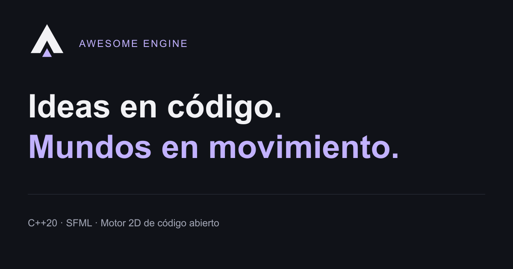
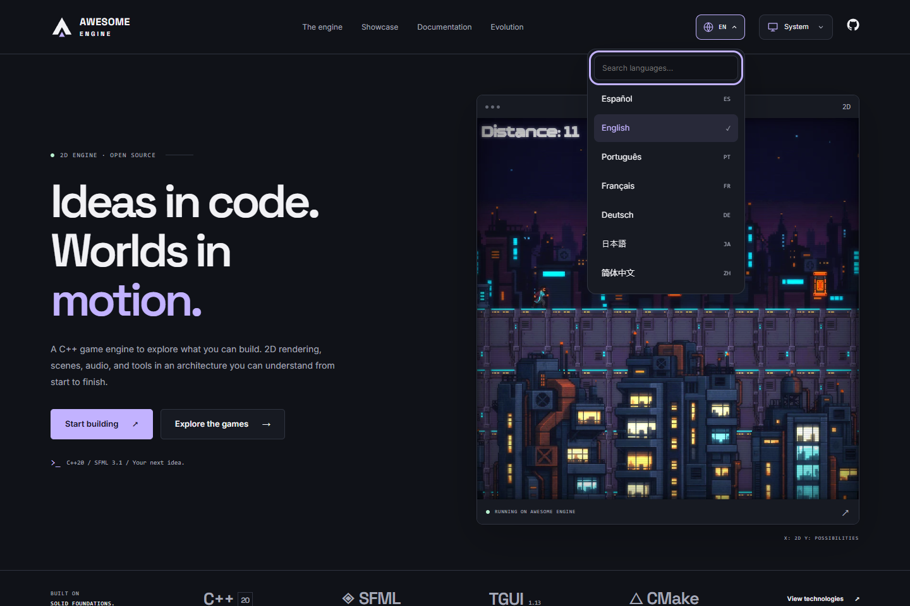
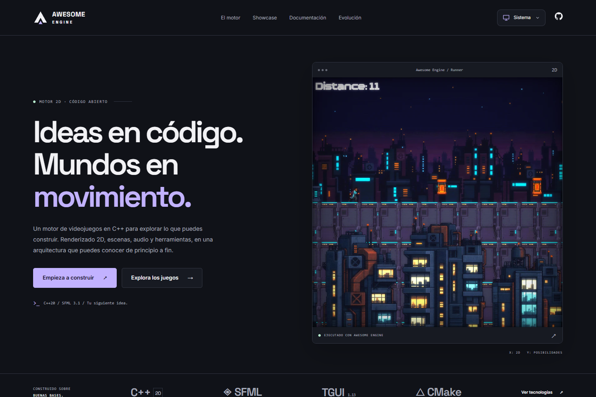
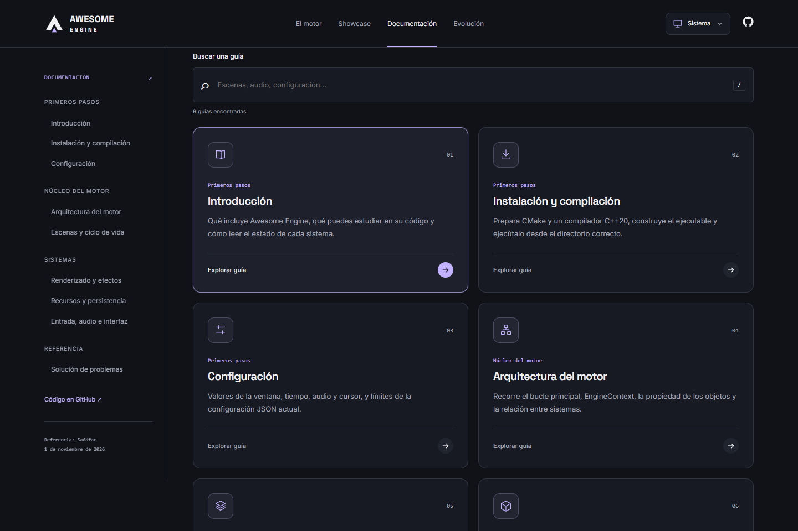
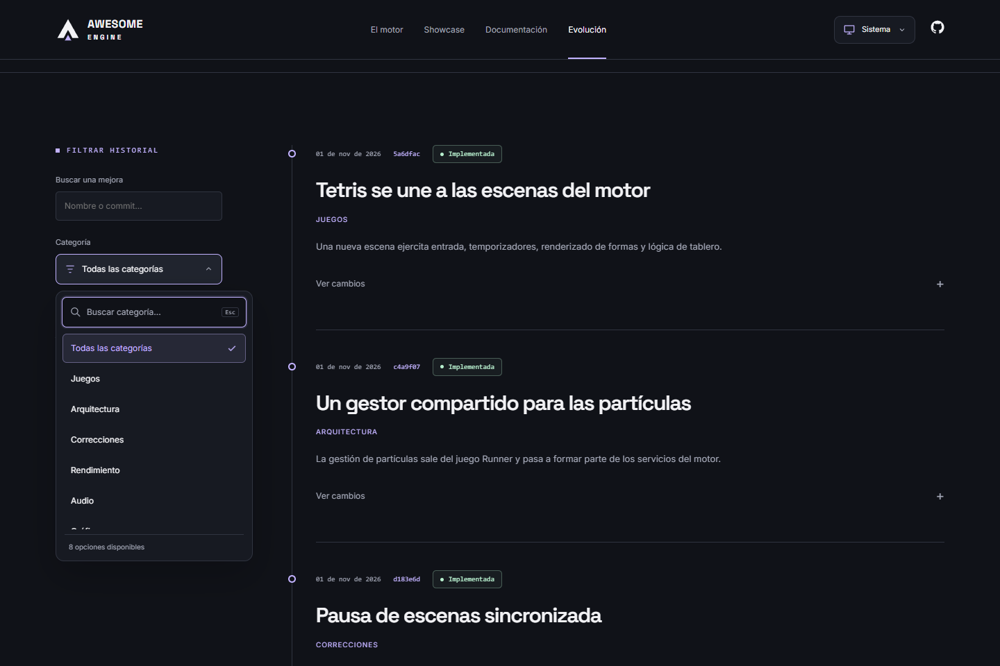
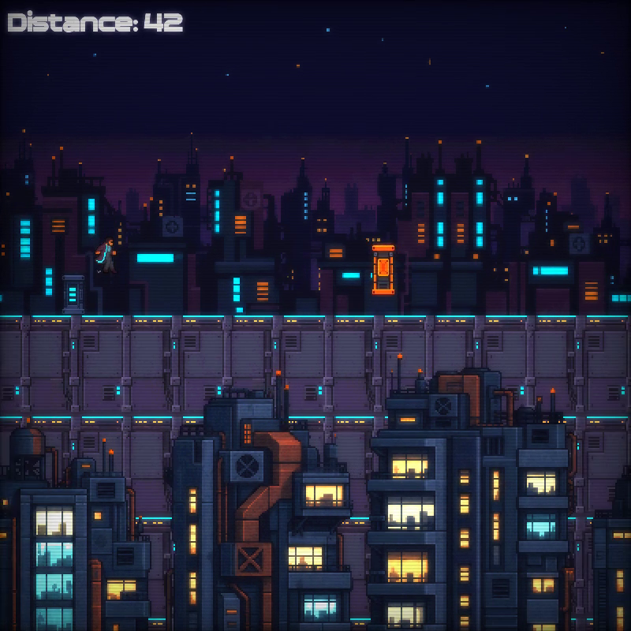
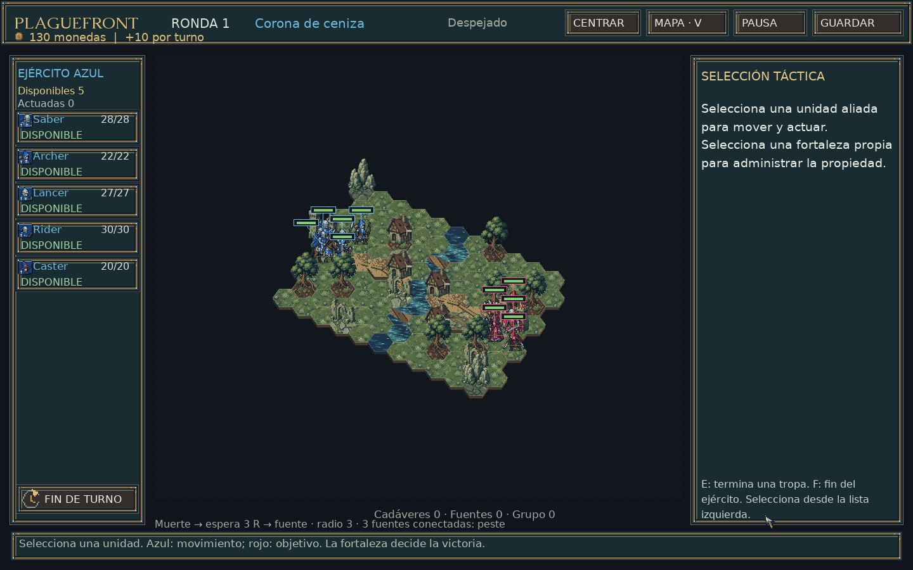

<p align="center">
  <a href="https://awesome-engine-web-arukado.web.app/">
    
  </a>
</p>

<h1 align="center">Awesome Engine · Sitio oficial</h1>

<p align="center">Ideas en código. Mundos en movimiento.</p>

<p align="center">
  <a href="https://github.com/Arukado01/awesome-engine-website/actions/workflows/ci-deploy.yml"></a>
  
  
  
  <a href="LICENSE"></a>
</p>

<p align="center">
  <a href="https://awesome-engine-web-arukado.web.app/">🌐 Sitio web</a> ·
  <a href="https://awesome-engine-web-arukado.web.app/docs/">📖 Documentación</a> ·
  <a href="https://awesome-engine-web-arukado.web.app/showcase/">🎮 Showcase</a> ·
  <a href="https://github.com/Arukado01/AwesomeEngine">⚙️ Código del motor</a>
</p>

Sitio de presentación, documentación y evolución de **Awesome Engine**, el motor 2D en C++ de Carlos Cortina. Este proyecto web es independiente del [repositorio del motor](https://github.com/Arukado01/AwesomeEngine): no compila, modifica ni distribuye su ejecutable.

- **Destino de producción:** [awesome-engine-web-arukado.web.app](https://awesome-engine-web-arukado.web.app).
- **Código del sitio:** [Arukado01/awesome-engine-website](https://github.com/Arukado01/awesome-engine-website).
- **Proyecto Firebase:** `awesome-engine-web-arukado`.

## Idiomas

La interfaz, las nueve guías, el historial, el showcase y los mensajes de los controles están disponibles en siete idiomas:

| Idioma             | Ruta   |
| ------------------ | ------ |
| Español            | `/`    |
| English            | `/en/` |
| Português (Brasil) | `/pt/` |
| Français           | `/fr/` |
| Deutsch            | `/de/` |
| 日本語             | `/ja/` |
| 简体中文           | `/zh/` |

El selector del encabezado permite buscar un idioma y conserva la página y sus anclas. Las rutas determinan el idioma; no hay redirecciones automáticas ni servicios externos de traducción. Cada página se genera con contenido traducido, `lang`, canonical y alternativas `hreflang`. Las imágenes y los videos originales se comparten entre idiomas.

[](https://awesome-engine-web-arukado.web.app/en/)

## Capturas de pantalla

Capturas reales de la interfaz del sitio. Los temas claro y oscuro comparten la misma estructura y las interacciones se adaptan a móvil, tablet y escritorio.

[](https://awesome-engine-web-arukado.web.app/)

| 📖 Biblioteca de guías                                                                                                            | 🔎 Historial y categorías                                                                                                               |
| --------------------------------------------------------------------------------------------------------------------------------- | --------------------------------------------------------------------------------------------------------------------------------------- |
| [](https://awesome-engine-web-arukado.web.app/docs/) | [](https://awesome-engine-web-arukado.web.app/evolucion/) |

## Qué incluye

Presentación del motor, capacidades verificadas, arquitectura, galería, nueve guías técnicas y una línea de tiempo alimentada por datos centralizados. El sitio ofrece temas claro, oscuro y sistema con un panel accesible de iconos, animaciones de entrada y al recorrer las secciones que respetan el movimiento reducido, navegación adaptable, tarjetas de documentación con iconos y hover estable, búsqueda de guías y de categorías dentro del selector de historial, metadatos sociales, sitemap y página 404.

El contenido técnico se basa en la auditoría de la revisión `5a6dfacd86414c4cdfaa7157b533330f173a3126`. Las funciones observadas únicamente en el árbol local se identifican como trabajo en desarrollo. No se anuncian versiones ni capacidades sin evidencia.

El formulario utiliza Gmail SMTP, Turnstile y límites de abuso. La función de contacto está desplegada y el propietario confirmó la recepción del mensaje y de la copia en una prueba real. Se envía una copia de confirmación al remitente cuando es posible. Consulta [la integración de contacto](docs/CONTACT.md) y [el procedimiento de despliegue](docs/DEPLOYMENT.md).

## 🎮 Showcase real

Incluye 10 capturas PNG y cuatro videos H.264: Runner (35 y 25 segundos, 800 × 800) y Plaguefront (40 y 29 segundos, 1440 × 900). Las grabaciones conservan velocidad y proporciones originales y no incluyen audio. Las galerías y los reproductores están verificados en móvil, tablet y escritorio. Procedencia y comandos: [CAPTURE.md](docs/CAPTURE.md).

| Runner · salto y parallax                                                                                                                                                | Plaguefront · tácticas y terreno                                                                                                                                                   |
| ------------------------------------------------------------------------------------------------------------------------------------------------------------------------ | ---------------------------------------------------------------------------------------------------------------------------------------------------------------------------------- |
| [](https://awesome-engine-web-arukado.web.app/showcase/#runner) | [](https://awesome-engine-web-arukado.web.app/showcase/#plagetale) |

Los videos se reproducen desde el showcase con controles, miniaturas y carga bajo demanda; estas imágenes no son mockups ni recreaciones.

## Stack

- Astro con generación estática y TypeScript.
- CSS con tokens de diseño y JavaScript limitado a interacciones.
- Markdown para documentación; TypeScript para datos del motor e historial.
- Fuentes Inter y Space Grotesk mediante Fontsource.
- Firebase Hosting; Cloud Functions Node.js 22 opcionales para contacto.
- Firestore para metadatos de límite de uso e idempotencia del backend.
- GitHub Actions para validación, producción y canales de preview.

Las versiones reproducibles están fijadas en los dos archivos `package-lock.json`.

## Preparar el entorno

Requisitos: **Node.js 22.23.4 o posterior** (CI y Functions usan Node 22; desarrollo validado con Node 24), npm y Git. Firebase CLI se necesita únicamente para emulación o despliegue; la versión usada por CI es 15.31.0.

```sh
git clone https://github.com/Arukado01/awesome-engine-website.git
cd awesome-engine-website
npm ci
npm --prefix functions ci
```

Copia `.env.example` a `.env` solo si necesitas ajustar opciones locales. No introduzcas contraseñas o claves privadas en variables `PUBLIC_*`: sus valores terminan en el navegador.

```sh
npm run dev
```

Astro imprime la URL local. Para comprobar los archivos de producción:

```sh
npm run build
npm run preview
```

El resultado estático queda en `dist/`. El servidor de desarrollo no ejecuta Cloud Functions.

## Validación

```sh
npm run check
npm run lint
npm test
npm run build
npm --prefix functions run check
```

El último comando valida tipos, lint, pruebas y compilación del backend. Las pruebas del envío usan dependencias controladas; no acreditan por sí solas recepción de un correo real.

La suite de navegador comprueba navegación, responsive, temas, documentación, formulario, medios y accesibilidad básica con Playwright y axe:

```sh
npm run test:e2e
```

En local utiliza Chrome instalado, construye una copia estática aislada en .e2e-dist y la sirve en el puerto 4323. No depende de las recargas del servidor de desarrollo ni sobrescribe dist. Ejecuta estas pruebas con `PUBLIC_CONTACT_ENABLED=false` y `PUBLIC_TURNSTILE_SITE_KEY` vacío; los escenarios del formulario utilizan respuestas controladas. CI instala Chromium con `npx playwright install --with-deps chromium` y fija esas variables únicamente en el paso de pruebas, conservando la configuración de la build de producción. Los fallos adjuntan diagnósticos disponibles a la ejecución de Actions durante siete días. Las revisiones visuales manuales complementan estos controles.

## Organización

```text
src/
  components/         Componentes reutilizables
  layouts/            Estructura común y metadatos
  pages/              Rutas y documentos renderizados
  styles/             Tokens y estilos
  scripts/            Interacciones y formulario
  content/docs/       Nueve guías originales en español
  content/docs-localized/  Las mismas guías en otros seis idiomas
  i18n/               Catálogos, mensajes, rutas y localización HTML
  data/engine.ts      Juegos, tecnologías y trabajo en desarrollo
  data/updates.ts     Historial central de mejoras
public/               Imágenes, favicon y recursos estáticos
functions/            Endpoint de contacto y pruebas
scripts/              Herramientas del proyecto
tests/                Verificaciones del sitio
.github/workflows/    Integración y despliegue continuos
docs/                 Auditoría, procedencia y operación
```

`firebase.json` publica exclusivamente Hosting. `firebase.functions.json` es la configuración alternativa para habilitar el backend de forma explícita. Ningún workflow despliega funciones ni cambia facturación automáticamente.

## Mantener las traducciones

- `src/i18n/locales.ts` define los siete idiomas y sus rutas.
- `src/i18n/catalogs/es.json` contiene los textos fuente; los otros seis JSON mantienen las mismas claves y traducen sus valores. Conserva placeholders como `{count}` y `{label}`.
- `src/middleware.ts` aplica los catálogos durante el renderizado estático. El parser HTML traduce texto y atributos accesibles, sin modificar código, scripts ni recursos. No se descarga el catálogo completo al navegador.
- `src/i18n/ui-messages.json` y `client.ts` suministran los mensajes de interacción y plurales localizados.
- Las guías se traducen como Markdown completo en `src/content/docs-localized/<idioma>/`. Conserva nombres de archivo, código y fuentes; los alias de encabezados españoles permiten cambiar de idioma sin perder el punto de lectura.
- Tras añadir texto al sitio, compila, actualiza el catálogo fuente con `node scripts/extract-i18n.mjs`, completa los seis catálogos y vuelve a compilar. La comprobación posterior a la compilación detecta frases o páginas sin traducción. Si la primera compilación falla por texto nuevo, ya habrá escrito el HTML necesario para la extracción.
- Ejecuta `npm test` y `npm run test:e2e` antes de publicar.

## Actualizar documentación y novedades

Para una guía, edita o añade un archivo en `src/content/docs/`:

```yaml
---
title: Título de la guía
description: Qué permite consultar esta página.
order: 10
category: Sistemas
---
```

Mantén órdenes únicos y enlaces a commits concretos del motor. Para una novedad, añade una entrada en `src/data/updates.ts` con `id`, `date`, `title`, `description`, `category`, `status`, `added`, `fixed`, `performance`, `architecture` y `source`. Conserva la fecha real y deja vacíos los apartados sin cambios demostrables. El panel se construye desde esa fuente; no necesitas duplicar componentes.

`src/data/engine.ts` concentra la información de juegos y tecnologías verificadas. Registrar una novedad en el sitio no hace commit ni publica cambios del motor.

Antes de enviar una actualización, ejecuta las validaciones y revisa la página resultante en móvil y escritorio. La [auditoría](docs/ENGINE-AUDIT.md) explica la base de cada afirmación.

## Desplegar Hosting

Para publicar la configuración de producción mediante el workflow existente:

```sh
gh workflow run ci-deploy.yml --repo Arukado01/awesome-engine-website --ref main
```

El workflow conserva la ruta del formulario cuando la variable `CONTACT_BACKEND_DEPLOYED` está activa. Para una publicación manual, consulta [DEPLOYMENT.md](docs/DEPLOYMENT.md).

El workflow valida pull requests y pushes a `main`. Tras validar `main`, despliega Hosting usando el secreto de GitHub `FIREBASE_SERVICE_ACCOUNT_AWESOME_ENGINE`. Si falta, el despliegue falla con un mensaje explícito. Los pull requests del mismo repositorio pueden crear previews temporales; los forks ejecutan validación sin recibir credenciales. Las URLs de preview aparecen en el resumen de la ejecución.

## Configuración del correo

El backend usa los secretos `GMAIL_APP_PASSWORD` y `TURNSTILE_SECRET_KEY` en Firebase, y la variable pública `PUBLIC_TURNSTILE_SITE_KEY` para el widget. El workflow de producción activa el formulario mediante `CONTACT_BACKEND_DEPLOYED`. Comprueba la recepción real en Gmail después de un despliegue o cambio de credenciales.

No pegues secretos en código, incidencias, commits o archivos de ejemplo.

## Licencias y recursos

El código original del sitio se publica bajo [MIT](LICENSE), copyright 2026 Carlos Cortina. Las dependencias, fuentes, capturas y recursos de terceros conservan sus licencias y atribuciones. La licencia del sitio no concede derechos adicionales sobre ellos; consulta [ASSETS.md](docs/ASSETS.md).

El repositorio excluye `.env` reales, secretos locales, credenciales, dependencias instaladas, cachés y artefactos generados. Los archivos `.env.example` contienen únicamente nombres y valores ilustrativos.
Tras cada despliegue, un job independiente y sin secretos ejecuta cuatro pruebas sobre la URL real de Hosting: páginas y 404, interacción móvil, guías y categorías buscables, y reproducción de los cuatro videos. Puede repetirse con PLAYWRIGHT_BASE_URL apuntando a producción o a un canal de preview del proyecto y npm run test:live.
